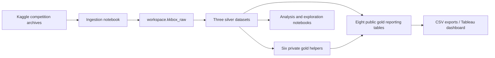

# KKBOX Databricks Pipeline

Source code for the KKBOX churn and listening analytics project: Kaggle ingestion, Lakeflow Declarative Pipelines silver cleanup, monthly gold reporting, and supporting analysis notebooks.

Exported from the Databricks workspace on **13 October 2026**. The running pipeline is named `bronze_to_silver`; despite that name, it defines both silver and gold datasets.

## Repository layout

```text
pipeline/
  transformations/             # Five source modules used by the live pipeline
    members.py                 # Member parsing and quality checks
    transactions.py            # Combine and clean transaction sources
    user_logs.py               # Combine and clean listening sources
    gold.py                    # Eight reporting tables and six private helpers
    churn_labels.py            # Documents exclusion of training labels
  pipeline.example.json        # Captured settings with a portable source path
notebooks/
  01_ingestion/                # Kaggle download, volume staging, Delta loading
  02_quality/                  # Original cleanup investigation notebooks
  03_analysis/                 # Engagement/churn and pricing analysis
  04_exploration/              # Member and subscription exploration
  05_exports/                  # Original table download queries
sql/
  bootstrap.sql                # Schemas required by the existing source code
  export_tables.sql            # All eleven public gold/silver SELECTs
docs/
  data-model.md                # Table grains, dependencies, and metric assumptions
  source_manifest.json         # Export-to-repository mapping and source hashes
scripts/
  validate_sources.py          # Local syntax, inventory, and credential checks
```

## Data flow



## Use in Databricks

1. Import or clone this repository into your Databricks workspace.
2. Run `sql/bootstrap.sql` with permission to create the project schemas.
3. Configure a Databricks secret scope named `kkbox` with key `kaggle-api-token`. The ingestion notebook reads this secret into `KAGGLE_API_TOKEN`; the original hard-coded token has been removed from the repository. The Kaggle account must have access to the KKBOX competition and have accepted its rules.
4. Import `notebooks/01_ingestion/kkbox_ingest.py` as a Databricks source notebook. It preserves the original ingestion and recovery cells, including alternative copy/extraction attempts. Review and run the applicable cells to load the raw tables rather than treating the historical notebook as a new automated job.
5. Open the existing `bronze_to_silver` pipeline, or configure a pipeline using `pipeline/pipeline.example.json`. Replace `/Workspace/path/to/kkbox-databricks-pipeline` with your actual repository folder. The pipeline source glob must include only `pipeline/transformations/**`.
6. The transformations use `pyspark.pipelines` and the Databricks-provided `spark` session. They run in Lakeflow Declarative Pipelines, rather than as standalone local Python scripts. Raw source tables must exist before a pipeline update.
7. Import the remaining `.py` notebooks as Databricks source notebooks for quality investigation, analysis, exploration, and export.

The captured pipeline configuration is triggered, serverless, Photon-enabled, and uses the `CURRENT` channel with default catalog `workspace` and default schema `default`. Dataset definitions explicitly target `workspace.kkbox_silver` and `workspace.kkbox_gold`. The example JSON intentionally omits the existing pipeline ID and user-specific workspace path. No deployment, pipeline update, or table refresh was performed while creating this repository.

## Raw prerequisites

The transformation modules read these existing tables:

- `workspace.kkbox_raw.members_v3`
- `workspace.kkbox_raw.transactions`
- `workspace.kkbox_raw.transactions_v2`
- `workspace.kkbox_raw.user_logs`
- `workspace.kkbox_raw.user_logs_v2`

The analysis notebooks also reference `workspace.kkbox_raw.train_v2`. Training labels and sample submissions remain in raw and are not published as silver datasets.

## Exporting data

Run each statement in `sql/export_tables.sql` separately and download its result using the filename in the adjacent comment. The original multi-statement notebook is retained under `notebooks/05_exports` for provenance.

The repository contains code only. CSVs, competition archives, credentials, and notebook result outputs are excluded. Databricks result downloads are limited to roughly 5 GB; large silver datasets need partitioned exports or writes to a Unity Catalog Volume for a complete export. The earlier `daily_listening_activity` and `subscription_transactions` CSV downloads reached this limit, so they should not be treated as confirmed full-table copies.

## Verification and provenance

```bash
python3 scripts/validate_sources.py
```

This checks Python syntax without importing Spark, the eleven public and six private pipeline datasets, recorded source hashes, and common credential literal patterns. It does not execute SQL or validate results on Databricks compute.

All twelve exported source files are included. Pipeline transformation logic is preserved; terminal newlines are normalized. The ingestion token cell is the sole substantive source edit and now uses a Databricks secret lookup. Two exploratory notebooks were renamed to describe their contents; `docs/source_manifest.json` records their original names and locations. No raw export ZIP is committed because the shared notebook archive contains the original credential.

References: [Databricks source export/import](https://docs.databricks.com/aws/en/notebooks/notebook-export-import), [Databricks pipeline settings](https://docs.databricks.com/aws/en/ldp/configure-pipeline), [Databricks result download limits](https://docs.databricks.com/aws/en/sql/user/sql-editor/results), [KaggleHub authentication](https://github.com/Kaggle/kagglehub#authentication).
